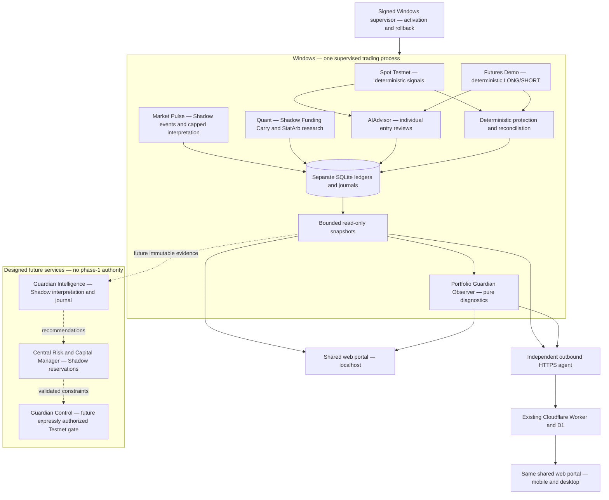
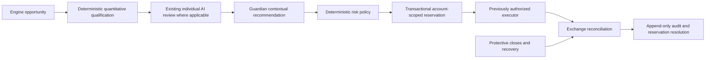

# CRYPTO-BOT 2.0 — Intelligent Trading Command Center

## Baseline and scope

Foundation candidate **0.10.41**, prepared from current main
`81ba4366cf587c16cae20d403974a340080c4d10` (0.10.40),
[PR #117](https://github.com/jlboper/Crypto-BOT/pull/117).
The predecessor's [publication](https://github.com/jlboper/Crypto-BOT/actions/runs/39089416208)
and [Linux/Windows safety checks](https://github.com/jlboper/Crypto-BOT/actions/runs/39089416215)
succeeded. The release operator verified its signature, Windows installation and
178/178 package hashes at **2026-10-18 02:27 UTC**. That evidence belongs to
0.10.40. Source, CI, publication, signature, installation and current operation
of 0.10.41 require their own checkpoints.

This document records the phase-0 audit and the interfaces for later phases.
Phase 1 reorganizes the shared portal and Windows presentation using existing
observations. It creates no financial service, reservation, trading veto,
allocation, new model call or execution permission. Guardian Intelligence,
Central Risk & Capital Management and Guardian Control are separate future
components. A visible card is not proof that its proposed service exists.

Evidence priority: authenticated current runtime and immutable journals;
installed signed inventory; actual source; executed CI/tests; documentation.
Older versioned sections are historical preparation records, not current status.
Read [AGENTS.md](AGENTS.md), [release operations](BOT_RELEASE_OPERATIONS.md),
[research methodology](RESEARCH_METHODOLOGY.md), [strategy evidence](STRATEGY_EVIDENCE.md),
[Market Pulse](MARKET_PULSE.md) and [Quant](QUANT_ARBITRAGE.md) before changing
financial behavior. Historical PAPER descriptions do not override today's
separate Testnet, Demo and Shadow architecture.

## Phase-0 architecture audit

One supervised Windows trading process owns Spot, the Futures forward test and
the optional Pulse/Quant services. The outbound independent agent reports bounded
credential-free projections and dispatches existing allowlisted controls; it is
not another trading engine. Local and remote portals use the same `web/` source.

| Component | Existing and reusable | Refactor or new work required | Principal risk / boundary |
| --- | --- | --- | --- |
| Spot | `engine.py`, `strategy.py`, broker, ledger, native OCO, entry claims | Future admission adapter only after Shadow comparison | Preserve current sizing, risk, AI review, stops and reconciliation |
| Futures | `futures_forward.py`, own ledger, conditional protection, fill recovery | Account-scoped adapter and uncertain-order evidence | Demo and Spot capital differ; leverage does not multiply notional |
| Individual AI | `ai_advisor.py`: Spot ALLOW/REJECT/REDUCE; Futures ALLOW/REJECT | Typed audit link to any future Guardian recommendation | Guardian must not replace this review or turn a rejected candidate into an order |
| Market Pulse | Ten dated eligible assets, five RSS sources, independent Shadow ledger and six-attempt/day AI cap | Later research/admission adapters, separately reviewed | Untrusted news, stale data and speculative claims; no exchange executor |
| Quant | Independent virtual ledger, Funding Carry, closed-minute evidence, replay and protective simulation | Independent calibration/OOS and richer execution stress | StatArb entry remains blocked; historical bars received now are not forward evidence |
| Guardian Observer | Pure `portfolio_guardian.py`, four scoped ledgers, overlaps, bounded alerts | Reuse evidence builder; do not insert it into trading cycles | No broker/E/S, reservations, veto, correlation model or cross-scope financial total |
| Guardian Intelligence | No model-backed Guardian service exists | New isolated Shadow analyzer, journal, replay and read-only query layer | Prompt injection, unsupported claims, stale recommendations, API cost |
| Capital Manager | `exposure_coordinator.py` prototype and synthetic tests | New durable state machine, reconciler and adapters for every participant | Prototype is not integrated; sharing account funds remains blocked |
| Guardian Control | No common control admission path exists | Future deterministic enforcement after explicit authority and validation | Never increase ceilings, reopen manual kills, delay exits or infer LIVE permission |
| Portal / Windows | Shared assets, authenticated snapshots, existing narrow controls | Phase-1 seven views and coherent labels, mobile navigation | Presentation must not claim stale/missing data or future authority is current |
| Agent / Cloudflare | Auth, CSRF validation, bounded optional contracts and compatibility fallback | Future typed additions must evolve producer, Worker and bridge together | Lost remote sync is not engine failure; independent import closure must survive |
| Snapshot acquisition | Spot opens SQLite with `mode=ro`; bounded existing financial projections are reusable evidence | Phase 2 needs an explicit read-only Futures adapter with ≤1 s timeout, without ledger construction | Existing Futures snapshot paths instantiate a ledger whose constructor can create/migrate tables and set WAL; do not call them a strict read-only service |
| Research | Frozen cohorts, immutable reports, OOS/forward methodology | Compare original and Guardian Shadow recommendations prospectively | Selection bias; no counterfactual profit or automatic strategy promotion |
| Signed updater | Main-only OIDC, Ed25519, anti-downgrade, activation barrier | Preserve procedure and each release checkpoint | Candidate must not mutate financial state before activation; code rollback preserves committed journals |

Code search finds no production caller constructing `ExposureCoordinator` or
calling its reservation protocol. It is a prototype plus tests, not a central
allocator protecting current accounts. Guardian is called from projection paths,
not Spot/Futures financial cycles. Its scoped ledger inventory is not complete
exchange-account reconciliation and its nominal stop distance excludes costs,
gaps and funding. Opposite positions in different environments are not a hedge.

Acquisition is a separate concern from the pure Guardian function. Current
`portal_snapshot.dashboard_snapshot` and the local Futures view construct
`FuturesTestnetLedger`; its constructor creates directories, sets WAL and runs
schema initialization/migrations. Phase 1 does not alter that financial code.
Before phase-2 frequent supervision, add an explicit `mode=ro`/query-only Futures
reader with bounded ≤1 s timeout and no constructor/migration effects. Current
multi-ledger snapshots are not one atomic global transaction: retain per-source
timestamps and quality, and never portray the capture as exact synchronous
pre-submit knowledge across engines.

`AIAdvisor` is preserved. In the checked-in configuration, reviews fail closed;
the class also has an explicit configurable fallback, so documentation must not
claim fail-closed behavior for every possible configuration. Spot claims its
entry/AI budget, reviews a deterministic candidate, then sizes and validates the
exchange plan. Futures sizes and reviews the exact proposed direction/notional,
then refreshes filters/budgets before submission. Existing protective and recovery
paths run independently of new-entry review. Foundation 2.0 changes none of this.

## Target admission pipeline — future, not wired in phase 1

In phases 2/3, this pipeline runs alongside original decisions as Shadow evidence;
its output cannot change the original order, sizing or timing. The applicable
individual review cannot be skipped. Quant and Pulse retain their existing
deterministic/interpretation paths; no new mandatory AI call is invented for them.
The final executable quantity can only stay equal or decrease relative to the
individual proposal and every approved deterministic cap. It must be rounded
conservatively and revalidated against current balances, filters and price.
The authorized executor alone owns exchange side effects. Protection/recovery
bypasses entry gates and remains available during pauses and Guardian failure.

## Proposed typed contracts

These are **design contracts**, not new phase-1 HTTP endpoints or Python APIs.
Use strict schemas, bounded arrays/strings, finite numbers, UTC timestamps with
explicit units, versioned policy/model identities and no arbitrary tool names,
URLs, Python expressions, SQL or embedded instructions. External text is evidence.
Unknown financial values are `null` with a reason, never fabricated zero.

| Record | Required identity and typed evidence | Authority |
| --- | --- | --- |
| `OpportunityV1` | `opportunity_id`, engine enum, strategy/cohort ID, asset/legs, environment enum, opaque account scope, direction, proposed quantity/notional/risk in explicit units, created/market/received/decision-cutoff UTC timestamps, source IDs/digests, policy version | Proposal only; no credentials or execution toggle |
| `IndividualReviewV1` | Review/opportunity IDs, ALLOW/REJECT/REDUCE for Spot or ALLOW/REJECT for Futures, finite confidence and multiplier 0..1, bounded reason codes, model and policy version, request/completed times, unavailable/error state | Existing engine-specific limits remain authoritative |
| `GuardianAssessmentV1` | Assessment/opportunity/review IDs, OBSERVE/RECOMMEND_ALLOW/RECOMMEND_REDUCE/RECOMMEND_REJECT/UNKNOWN, regime/conflict evidence, scoped constraints, evidence cutoff and expiry, model/policy version, original decision reference | Shadow recommendation; no numerical override or broker access |
| `RiskDecisionV1` | Decision/assessment IDs, risk state, scoped approved ceilings, original and final quantity/notional/risk, deterministic calculation version, reasons, quote/balance/filter timestamps and digests | Proposed future enforcement only within approved ceilings |
| `CapitalReservationV1` | Reservation/idempotency/opportunity IDs, environment + account scope + quote asset, all legs, notional/cost/margin/stop-risk units, policy epoch, durable state, linked order/client IDs and reconciliation evidence | Virtual in phase 3; no account movement |
| `ExecutionOutcomeV1` | Reservation/decision/order IDs, actual fills/costs, protected/uncertain state, exchange and received timestamps, reconciliation result, final release evidence | Executor/reconciler facts; never an AI assertion |
| `ReadOnlyAnswerV1` | Query ID, as-of UTC, bounded answer, source snapshot/journal IDs, freshness/completeness, unsupported/unknown fields | Explanation only; no commands or financial writes |

Freeze the information available at each cutoff, including the **first local
receipt**, not merely market/publication time. Replaying must use the recorded
schema, hypotheses, method/window references and immutable evidence. Later news,
bar backfill, revised prices or model output cannot change earlier knowledge.
Every journal links original signal, individual review, Guardian assessment,
deterministic constraints, final amount and observed outcome. Shadow outcomes and
actual Testnet/Demo fills must remain distinguishable. Logs exclude credentials
and unnecessary private account data.

## Capital and deterministic risk design

Scopes are explicit combinations of environment and opaque account identity.
SHADOW includes engine/cohort virtual-wallet identity. PAPER, Spot Testnet,
Futures Demo and separate Shadow wallets never form a spendable combined balance
or consolidated real P&L. Reports may compare eligible periods/methodologies and
must explain incomparability. Visual allocation is descriptive until a manager
is implemented and separately authorized.

Reuse the prototype's `BEGIN IMMEDIATE`, unique identity and scoped duplicate
checks as building blocks. Do not treat `confirmed_flat=True` from a caller as
verified exchange evidence or an existing complete reconciliation journal.
The future manager needs atomic multi-leg reservations, durable policy epochs,
fresh balance/filter evidence, coherent accounting for cash/margin/cost buffers,
pending orders and open exposure without double counting, concurrent admission,
restart/replay and rollback tests. A unique `(scope,symbol)` row alone cannot
represent the complete lifecycle of several legs or partial fills.

Proposed states: `PROPOSED → RESERVED → SUBMITTING → OPEN/PARTIALLY_FILLED`,
with `REJECTED`, `RECONCILING`, `UNKNOWN` and `RELEASED` resolved by facts.
An expired request, timeout, process restart or lease must **never** release funds
for an order that may exist. Only proven non-submission or fresh reconciled flat/
cancelled evidence permits release, with retained audit/idempotency history.
Submission and actual exchange hedging are not SQL-atomic. Uncertain order status
retains the reservation and requires reconciliation. No withdrawals/transfers.

Proposed risk states, scoped to the applicable account and policy:

| State | Future permitted response |
| --- | --- |
| `NORMAL` | Admit only within existing approved budgets |
| `CAUTION` | Record concern and apply only previously approved conservative restrictions |
| `RISK_REDUCED` | Lower new-entry amounts/exposure within approved policy; never raise ceilings |
| `ENTRY_HALTED` | Block new entries; preserve existing protection and reconciliation |
| `RECOVERY_REQUIRED` | Block entries until identity, orders, balances and journals reconcile |

These are not current global runtime states. Spot/Futures retain their present
risk policies and manual kills. Foundation does not retune them. Future Guardian
failure cannot stop protective exits; an enabled admission mode must have a
preapproved deterministic conservative fallback, never silently fall back to
unrestricted entries or claim lost evidence is zero risk.

## Intelligence, queries, API budgets and authority

Phase 1 adds **zero Guardian API calls, zero model attempts/day and zero additional
model-service charges**. It adds no model selector, paid infrastructure or provider
subscription. Existing Spot/Futures/Pulse model settings and separate budgets
remain. Quant and current Guardian Observer use deterministic computation.

Before phase 2 calls any model, define its independent durable daily attempt and
cost caps, input/output-token bounds, timeouts, concurrency/backoff, cache keys
including policy/evidence version, TTL/expiry and visible usage accounting.
Claim budget before requests, count failed attempts conservatively and never
reuse an expired recommendation for admission. Depleted budget means UNKNOWN /
deterministic fallback under that phase's approved policy. Verify model access,
current documentation/pricing and credential scope before adding spend; current
source model names do not prove API availability. No model change is authorized
by this architecture document. Guardian cannot consume the Pulse-only cap.

Future natural-language questions read validated snapshots/journals only: why
Spot/Futures did not enter, latest individual review, engine health, BTC exposure,
observed conflicts and research results. Correlation clusters require an explicit
fresh deterministic model. “Best strategy”, “without AI” and “losses avoided” are
UNKNOWN unless a preregistered comparable evaluation supports them. Summing later
losses of rejected trades is not a valid counterfactual. Query text, news or model
output cannot invoke orders, settings, risk changes, pauses, credentials or tools.
This read-only query service is pending; a phase-1 Guardian card does not supply it.

| Autonomy level | Design authority | Activation condition |
| --- | --- | --- |
| 0 — Observer | Current/default: report facts; future Shadow recommendations have no side effects | Existing Observation authority only |
| 1 — Safety Controller | Future reduce/block admission within expressly approved policy | Owner authorization + Shadow validation + reversible fallback |
| 2 — Capital Orchestrator | Future allocate/reserve within approved account-scoped budgets | Separate owner authorization, common lifecycle/reconciliation and stress tests |
| 3 — Supervised Autonomy | Future bounded supervised behavior with audit and deterministic constraints | Separate owner authorization and validated rollback; no LIVE |

No level authorizes LIVE, withdrawals, increased risk, strategy promotion or
removing protection. Transitions are explicit, audited and reversible; a version
bump or successful backtest is not an authorization.

## Next implementation slices — phase 2 and phase 3

### Phase 2 minimum functional Guardian Intelligence

Create an optional `GuardianService` inside the existing process, started only
after signed activation. One daemon evaluates at most once per 60 seconds after
completion; failure is isolated from other services. After implementing the
strict read-only acquisition adapter identified above, it reads credential-free
evidence and writes only its own additive SQLite journal. It must not directly
reuse a snapshot path that constructs/migrates the operational Futures ledger.
Snapshot/HTTP reads never initialize the service or write financial state.
Use bounded retained evidence/digests, append-only assessments and separate
operational metadata; initialize no exchange client and import no broker.

The first useful end-to-end slice is: capture scoped/fresh evidence → deterministic
conflict/concentration and evidence-quality assessment → frozen Shadow journal →
bounded Guardian projection → portal explanation with source/time references.
Regime may be UNKNOWN: source market returns without sufficient reproducible
history do not establish a regime model. Candidate advice is limited to observed
proposals/reviews, with “post-decision observation” explicit where necessary;
it is not a pre-submit veto or a replay of facts absent at the original decision.
Implement read-only questions over these records with deterministic answers first.

Current snapshots supply engine identity, environment, ledger positions/marks,
freshness, available scoped capital/limits, native-protection status, overlaps,
recent signals/reviews/decisions and separate research reports. Missing or
incomplete inputs include a common cross-engine opportunity ID, immutable full
pre-submit candidate quantity/cost/risk for every engine, a common account identity,
complete exchange pending-order inventory, synchronized validated correlation
history and causal counterfactual cohorts. Mark them UNKNOWN; do not reconstruct
them from a later fill, latest model review or another environment's balance.

AI is optional and initially disabled: own durable default **0 attempts/day**.
A proposed future hard ceiling is **2/day**, separately approved and metered; it
must not reuse individual/Pulse budgets or silently add spend. Use a strict
read-only output schema, bounded input/output/response bytes, timeout, cache TTL,
failure accounting and no tools. Model selection/access/pricing and credential
authorization must be verified before enabling it. No AI is required for the
deterministic first slice or allowed in protection/recovery.

Acceptance: synthetic stale/partial/poisoned evidence, prompt injection, bounded
CPU/RAM/SQLite growth, duplicate events, single-owner service, restart recovery,
budget exhaustion/timeouts and own pause must not affect other engines. Replaying
the same frozen assessment must be reproducible. A matched prospective journal
compares original and recommended decisions without claiming avoided losses.
New optional contracts must keep old-agent/Worker compatibility and ≤ existing
sync limits; adding a dedicated service does not imply new remote control rights.

### Phase 3 minimum functional Capital Manager Shadow

Add a separate virtual reservation ledger and pure risk evaluator; do not wire
them into existing executors. Consume versioned phase-2/engine proposals with
complete risk evidence or return UNKNOWN/REJECT. Record simulated admission and
outcomes in the portal so concurrency/recovery can be tested end-to-end while
original trading proceeds unchanged. New virtual capital needs an explicit,
dated policy/cohort and funding source; never manufacture a sum of current wallets.

Use parent scope `(environment, account_identity, quote_asset)` for account totals
and child engine/cohort budgets. Making engine part of the only account key would
hide conflicts between engines sharing the same future exchange account. Shadow
wallets stay engine/cohort isolated unless an explicit shared **virtual scenario**
registers all participants; it must never imply actual Testnet sharing.

Persist each event and legal transition transactionally with unique idempotency
and client-order identities. Distinguish reservation status from order/position
facts: `PENDING`, `UNKNOWN`, `PARTIAL`, `FILLED`, `CANCEL_REQUESTED`,
`RECONCILED` and the linked reservation's retained/released amounts. Reserve all
legs/cost buffers in one SQLite transaction; test concurrent competing engines,
duplicate retries, crash before/after each transition and partial-leg unwind.
Only reconciled unused amounts can be released. Timeout, cancel request and
missing remote heartbeat are not evidence of cancellation or a flat position.

Existing Guardian capital can be stale, ledger-only or nominal stop distance;
it is insufficient to certify spendable exchange funds and inclusive stop risk.
Fresh complete account/order/filter identity, fee/margin methodology and adapter
participation remain prerequisites for later actual admission. A pure evaluator
may reject incomplete evidence and apply approved ceilings; it cannot infer a
new global loss budget, increase individual risk or allocate by model confidence.
All phase-3 reservations are simulated. Real order journals/protection remain
owned by current engines, and a manager failure cannot pause or close them.

Accept phase 3 only after deterministic accounting invariants, account/environment
isolation, multi-leg costs, unknown-order retention and durable reconciliation
pass tests and forward observation. Actual common capital enforcement remains a
later explicitly authorized Control phase, with reviewed adapters for every bot.

## Delivery phases and verification gates

Each phase records **designed → implemented → tested → published → signed →
installed → operatively verified** separately. “Pending” is not “unavailable data
equals failure”; an empty market/decision view can be legitimate observation.

| Phase | Scope and current status | Exit evidence |
| --- | --- | --- |
| 0 — Audit | Designed/documented in candidate 0.10.41; source, contracts and predecessor CI reviewed | Component map, gaps, invariants and versioned plan reviewed |
| 1 — Command Center | Seven shared views and Windows naming in implementation; no financial effect | Existing contracts/controls, mobile/local/remote, auth, Python/Node/Windows/Linux; its own signed install and fresh runtime evidence |
| 2 — Guardian Intelligence | Designed; not implemented/tested/published/installed | Shadow journal, deterministic/AI separation, prompt-injection/cost/freshness tests; original-vs-recommendation prospective comparison |
| 3 — Risk & Capital Shadow | Designed; prototype alone is insufficient | Concurrent/idempotent virtual reservations, unknown-order recovery, multi-leg accounting and restart evidence; no trading side effect |
| 4 — Quant research | Existing 0.10.40 Shadow foundation installed/verified; additional calibration pending | Historical/OOS/forward and net-cost/stress evidence; StatArb remains blocked |
| 5 — Guardian Control Testnet | Pending; not authorized by phase 1 or this roadmap | Explicit future owner authorization, common admission/reconciliation, safety and rollback validation |
| 6 — Comparative evaluation | Methodology design; no causal Guardian effectiveness claimed | Comparable cohorts, periods, environments, net costs and uncertainty; no automatic risk increase |

Phase 1 navigation: **Command Center**, **Portfolio & Capital**, **Trading Engines**,
**Guardian AI**, **Operations & Decisions**, **Research Lab**, **System & Settings**.
Use a compact desktop sidebar/mobile navigation, consistent four-engine cards,
existing interactive charts and filters, folds/details, explicit timestamps,
freshness/unknown states and current authentication/CSRF behavior. Portfolio &
Capital uses existing scoped Guardian evidence; it is not an operational allocator.
Guardian AI clearly identifies current Observer and pending Intelligence/Control.
Existing narrow pause/update controls retain their authorization and meaning;
the new views cannot change risk or enable execution. Windows remains coherent
with the shared portal and must not launch a second engine to refresh its look.

Every implementation phase requires its own small reversible PR and release from
updated main. Preserve operating SQLite, configurations, keys, individual kills,
native-protection/order journals, signed inventory and anti-downgrade sequence.
The supervisor's activation barrier precedes financial mutation. Recovery after a
committed update retains financial state; pre-commit backup coverage must be
checked explicitly rather than assuming every SQLite file is backed up.
Never force a pending review or weaken OIDC, exact-main/deployed-SHA checks,
Ed25519, health checks or rollback to publish the Command Center.
