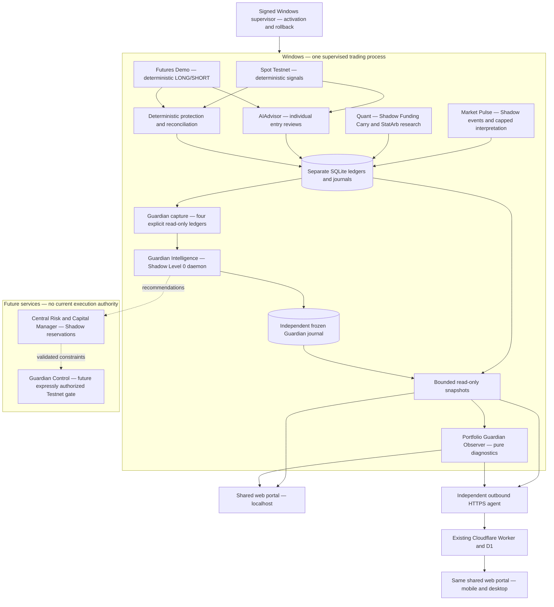
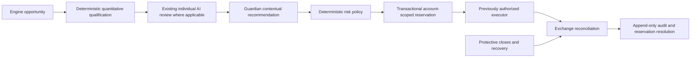

# CRYPTO-BOT 2.0 — Intelligent Trading Command Center

## Current checkpoint — installed 42 / corrective candidate 43

**0.10.42 is published, signed and installed**, main
`b1e065b1c4934eef80cf4a6d39c52bafa1abb5de`, [PR #119](https://github.com/jlboper/Crypto-BOT/pull/119).
[Publication 39181606398](https://github.com/jlboper/Crypto-BOT/actions/runs/39181606398)
and [safety 39181606401](https://github.com/jlboper/Crypto-BOT/actions/runs/39181606401)
succeeded. At **2026-10-19 00:42:33 UTC**, Ed25519, **188/188 installed hashes**
and five shared-web assets matched. Engine PID 3680 retained one Spot/five Futures
positions, native protections ARMED and zero observed unprotected quantity.
The independent agent initially had 9/11 current modules at that cut. Signed
auto-refresh was verified at **00:54:20 UTC**: agent PID 21344, **11/11 modules**,
`sync_ok`, and two fresh healthy heartbeats. Engine PID 3680 was unchanged;
Spot 1/Futures 5 remained native ARMED with zero observed unprotected quantity.

Guardian is **not fully operatively verified**: its first real record replays MATCH,
but report state is PARTIAL with **0/4 valid sources**, all UNKNOWN for
`WAL_SIDECARS_UNAVAILABLE`. Idle WAL databases may normally have no persistent
WAL/SHM sidecars. Rejecting them prevents valid observation; publication and passing
synthetic tests did not establish operating source acquisition. One real advisory
attempt is FAILED with unknown usage/cause; do not infer exhausted quota or credits.

Candidate **0.10.43**, branch `fix/guardian-readonly-wal-v01043`, is a narrow
correction: normal SQLite `mode=ro`/`query_only` reads may use transient WAL/SHM
metadata without financial DML, constructors, migrations, immutable copies or
stale snapshots. Preserve source timestamps, inventories, freshness and causal
checks. A deterministic prefilter must suppress model calls when every source is
UNKNOWN; bounded error diagnostics must expose safe codes, never response bodies
or secrets. Financial balances/positions/journals and current risk stay unchanged.
43 full offline Python passed **777/777**, no failures/errors/skips, **238.609 s**
in `TEST_RESULTS.json` at 00:55:17 UTC; external network blocked, no bot started.
PR/main CI, publication, signature, installation and runtime verification remain
pending. Existing 42 test counts below are
historical evidence, not 43 results.

Candidate evidence at **00:47:04 UTC**: standard SQLite RO backups of the four
operating schemas into temporary copies yielded four FRESH/complete captures
(Spot 1/Futures 5/Pulse 1/Quant 0) and descriptive BTC SIDEWAYS. No engine,
provider or credential loader ran; temporary copies were removed. This validates
43's reader against actual schemas, **not installed 43 operation**. Focused
capture/service tests: 87 PASS; isolated all-UNKNOWN no-AI regression: 1 PASS.
Additional local 43 validation: **35 AI tests PASS (6.961 s)**, **180/180 Node
PASS (106.485 s)**, Windows PowerShell 5.1 lifecycle/view checks, portal build and
diff PASS. Full Python 777/777 PASS is recorded above; rollout remains pending.

Capital Protocol Lab remains an external **synthetic** prototype, excluded from
this corrective release. It is not Capital Manager observing real engine proposals;
common immutable candidate/account adapters, Capital Manager runtime and Guardian
Control remain pending without financial authorization or automatic promotion.

## Historical 0.10.42 preparation checkpoint

Candidate **0.10.42 — Guardian Intelligence Shadow**, prepared from current main
`022fb9135d165d5c52f12b65aa9628ab8c1436af` (0.10.41),
[PR #118](https://github.com/jlboper/Crypto-BOT/pull/118).
The predecessor's [publication](https://github.com/jlboper/Crypto-BOT/actions/runs/39134814222)
and [Linux/Windows safety checks](https://github.com/jlboper/Crypto-BOT/actions/runs/39134814202)
succeeded; signature and Windows installation matched **178/178 hashes**.
The 2026-10-18 **14:16:30 UTC** continuity audit observed one existing engine PID
19240, one Spot and nine Futures positions with native protections ARMED and no
observed unprotected quantity. Independent agent PID 9372 had recent HTTPS sync and 11/11
modules. Existing sampled financial rows had zero missing/changed rows; secrets,
risk settings and hypotheses were unchanged. This is dated predecessor evidence,
not proof of 0.10.42 installation or future liveness.

Phase 1's seven shared-web views and coherent Windows presentation are installed
in 0.10.41. Candidate 42 implements phase-2 observational intelligence, with
read-only acquisition, deterministic reports and its own frozen journal. Optional
AI explains observations with a separate bounded budget; it does not alter a
report or any trade. Eight closed local query intents explain the displayed
assessment without APIs, SQL or tools. Full local validation passed: **767/767
offline Python tests (361.510 s), 180/180 Node tests (85.515 s), Windows PowerShell
5.1 lifecycle/view checks, portal build and `git diff --check`**. Browser QA at
1366, 360 and 768 px showed no horizontal overflow and one Guardian workspace.
PR/main CI, publication, signature, installation and operative verification of 42
remain pending. Central Risk & Capital Management, Guardian Control, a general
server-side natural-language/journal query service and shared-account enforcement
remain future work. A card or Shadow review never confers execution authority.

A later predecessor audit at **19:10 UTC** again verified 178/178 installed hashes,
engine PID 19240, agent PID 13056 and one Spot/nine Futures positions with native
protections ARMED and zero observed unprotected quantity. This is still 41 evidence.

Evidence priority: authenticated current runtime and immutable journals;
installed signed inventory; actual source; executed CI/tests; documentation.
Older versioned sections are historical preparation records, not current status.
Read [AGENTS.md](AGENTS.md), [release operations](BOT_RELEASE_OPERATIONS.md),
[research methodology](RESEARCH_METHODOLOGY.md), [strategy evidence](STRATEGY_EVIDENCE.md),
[Market Pulse](MARKET_PULSE.md) and [Quant](QUANT_ARBITRAGE.md) before changing
financial behavior. Historical PAPER descriptions do not override today's
separate Testnet, Demo and Shadow architecture.

## Phase-0 architecture audit

One supervised Windows trading process owns Spot, the Futures forward test and
the optional Pulse/Quant/Guardian observation services. The outbound independent agent reports bounded
credential-free projections and dispatches existing allowlisted controls; it is
not another trading engine. Local and remote portals use the same `web/` source.

| Component | Existing and reusable | Refactor or new work required | Principal risk / boundary |
| --- | --- | --- | --- |
| Spot | `engine.py`, `strategy.py`, broker, ledger, native OCO, entry claims | Future admission adapter only after Shadow comparison | Preserve current sizing, risk, AI review, stops and reconciliation |
| Futures | `futures_forward.py`, own ledger, conditional protection, fill recovery | Account-scoped adapter and uncertain-order evidence | Demo and Spot capital differ; leverage does not multiply notional |
| Individual AI | `ai_advisor.py`: Spot ALLOW/REJECT/REDUCE; Futures ALLOW/REJECT | Typed audit link to any future Guardian recommendation | Guardian must not replace this review or turn a rejected candidate into an order |
| Market Pulse | Ten dated eligible assets, five RSS sources, independent Shadow ledger and six-attempt/day AI cap | Later research/admission adapters, separately reviewed | Untrusted news, stale data and speculative claims; no exchange executor |
| Quant | Independent virtual ledger, Funding Carry, closed-minute evidence, replay and protective simulation | Independent calibration/OOS and richer execution stress | StatArb entry remains blocked; historical bars received now are not forward evidence |
| Guardian Observer | Pure `portfolio_guardian.py`, four scoped ledgers, overlaps, bounded alerts | Reuse evidence builder; do not insert it into trading cycles | No broker/E/S, reservations, veto, correlation model or cross-scope financial total |
| Guardian Intelligence | Installed 42: isolated Shadow service, journal/replay and eight local queries; first real record MATCH but four sources UNKNOWN | Corrective 43 WAL/SHM reader, all-UNKNOWN deterministic AI prefilter and safe diagnostics; local 777 Python/180 Node passed, rollout/runtime pending | No veto/order hooks; model attempt FAILED with unknown cause/usage; no claim of complete operating acquisition |
| Capital Manager | `exposure_coordinator.py` prototype and synthetic tests | New durable state machine, reconciler and adapters for every participant | Prototype is not integrated; sharing account funds remains blocked |
| Guardian Control | No common control admission path exists | Future deterministic enforcement after explicit authority and validation | Never increase ceilings, reopen manual kills, delay exits or infer LIVE permission |
| Portal / Windows | Installed 41: seven shared views, mobile navigation, coherent labels and existing authenticated controls | Candidate 42 projects actual Guardian intelligence and freshness | Presentation must not claim stale/missing data or future authority is current |
| Agent / Cloudflare | Auth, CSRF validation, bounded optional contracts and compatibility fallback | Future typed additions must evolve producer, Worker and bridge together | Lost remote sync is not engine failure; independent import closure must survive |
| Snapshot acquisition | Candidate 42 uses explicit `mode=ro`/query-only readers for four ledgers, 0.25 s connection timeout, bounded inventories | Validate schemas/source timestamps per ledger; unavailable/overflow stays unknown | Legacy dashboard construction can initialize Futures; Guardian does not call that path |
| Research | Frozen cohorts, immutable reports, OOS/forward methodology | Compare original and Guardian Shadow recommendations prospectively | Selection bias; no counterfactual profit or automatic strategy promotion |
| Signed updater | Main-only OIDC, Ed25519, anti-downgrade, activation barrier | Preserve procedure and each release checkpoint | Candidate must not mutate financial state before activation; code rollback preserves committed journals |

Code search finds no production caller constructing `ExposureCoordinator` or
calling its reservation protocol. It is a prototype plus tests, not a central
allocator protecting current accounts. Guardian is called from projection paths,
not Spot/Futures financial cycles. Its scoped ledger inventory is not complete
exchange-account reconciliation and its nominal stop distance excludes costs,
gaps and funding. Opposite positions in different environments are not a hedge.

Acquisition is a separate concern from the pure Guardian function. Current
`portal_snapshot.dashboard_snapshot` and the local Futures view construct
`FuturesTestnetLedger`; its constructor creates directories, sets WAL and runs
schema initialization/migrations. Phase 1 did not alter that financial code.
Candidate 42 resolves the Guardian acquisition blocker with a separate explicit
`mode=ro`/query-only reader, 0.25 s connection timeout and no ledger constructor/
migration effects. Its daemon does not call the old dashboard helper. Legacy
dashboard behavior is not silently redefined. Current
multi-ledger snapshots are not one atomic global transaction: retain per-source
timestamps and quality, and never portray the capture as exact synchronous
pre-submit knowledge across engines.

`AIAdvisor` is preserved. In the checked-in configuration, reviews fail closed;
the class also has an explicit configurable fallback, so documentation must not
claim fail-closed behavior for every possible configuration. Spot claims its
entry/AI budget, reviews a deterministic candidate, then sizes and validates the
exchange plan. Futures sizes and reviews the exact proposed direction/notional,
then refreshes filters/budgets before submission. Existing protective and recovery
paths run independently of new-entry review. Foundation 2.0 changes none of this.

## Target admission pipeline — future, not wired in phases 1/2

Phase 2 records contemporaneous observations alongside original decisions; it
cannot claim a complete pre-submit pipeline when those records do not exist.
Phase 3 will evaluate complete proposals in simulation. Their output cannot
change the original order, sizing or timing. The applicable
individual review cannot be skipped. Quant and Pulse retain their existing
deterministic/interpretation paths; no new mandatory AI call is invented for them.
The final executable quantity can only stay equal or decrease relative to the
individual proposal and every approved deterministic cap. It must be rounded
conservatively and revalidated against current balances, filters and price.
The authorized executor alone owns exchange side effects. Protection/recovery
bypasses entry gates and remains available during pauses and Guardian failure.

## Proposed typed contracts

The admission/reservation records below remain **design contracts**. Candidate
42 implements a bounded observational report rather than that execution pipeline.
Use strict schemas, bounded arrays/strings, finite numbers, UTC timestamps with
explicit units, versioned policy/model identities and no arbitrary tool names,
URLs, Python expressions, SQL or embedded instructions. External text is evidence.
Unknown financial values are `null` with a reason, never fabricated zero.

| Record | Required identity and typed evidence | Authority |
| --- | --- | --- |
| `OpportunityV1` | `opportunity_id`, engine enum, strategy/cohort ID, asset/legs, environment enum, opaque account scope, direction, proposed quantity/notional/risk in explicit units, created/market/received/decision-cutoff UTC timestamps, source IDs/digests, policy version | Proposal only; no credentials or execution toggle |
| `IndividualReviewV1` | Review/opportunity IDs, ALLOW/REJECT/REDUCE for Spot or ALLOW/REJECT for Futures, finite confidence and multiplier 0..1, bounded reason codes, model and policy version, request/completed times, unavailable/error state | Existing engine-specific limits remain authoritative |
| `GuardianAssessmentV1` | Assessment/opportunity/review IDs, OBSERVE/RECOMMEND_ALLOW/RECOMMEND_REDUCE/RECOMMEND_REJECT/UNKNOWN, regime/conflict evidence, scoped constraints, evidence cutoff and expiry, model/policy version, original decision reference | Shadow recommendation; no numerical override or broker access |
| `RiskDecisionV1` | Decision/assessment IDs, risk state, scoped approved ceilings, original and final quantity/notional/risk, deterministic calculation version, reasons, quote/balance/filter timestamps and digests | Proposed future enforcement only within approved ceilings |
| `CapitalReservationV1` | Reservation/idempotency/opportunity IDs, environment + account scope + quote asset, all legs, notional/cost/margin/stop-risk units, policy epoch, durable state, linked order/client IDs and reconciliation evidence | Virtual in phase 3; no account movement |
| `ExecutionOutcomeV1` | Reservation/decision/order IDs, actual fills/costs, protected/uncertain state, exchange and received timestamps, reconciliation result, final release evidence | Executor/reconciler facts; never an AI assertion |
| `ReadOnlyAnswerV1` | Query ID, as-of UTC, bounded answer, source snapshot/journal IDs, freshness/completeness, unsupported/unknown fields | Explanation only; no commands or financial writes |

Freeze the information available at each cutoff, including the **first local
receipt**, not merely market/publication time. Replaying must use the recorded
schema, hypotheses, method/window references and immutable evidence. Later news,
bar backfill, revised prices or model output cannot change earlier knowledge.
Every journal links original signal, individual review, Guardian assessment,
deterministic constraints, final amount and observed outcome. Shadow outcomes and
actual Testnet/Demo fills must remain distinguishable. Logs exclude credentials
and unnecessary private account data.

## Capital and deterministic risk design

Scopes are explicit combinations of environment and opaque account identity.
SHADOW includes engine/cohort virtual-wallet identity. PAPER, Spot Testnet,
Futures Demo and separate Shadow wallets never form a spendable combined balance
or consolidated real P&L. Reports may compare eligible periods/methodologies and
must explain incomparability. Visual allocation is descriptive until a manager
is implemented and separately authorized.

Reuse the prototype's `BEGIN IMMEDIATE`, unique identity and scoped duplicate
checks as building blocks. Do not treat `confirmed_flat=True` from a caller as
verified exchange evidence or an existing complete reconciliation journal.
The future manager needs atomic multi-leg reservations, durable policy epochs,
fresh balance/filter evidence, coherent accounting for cash/margin/cost buffers,
pending orders and open exposure without double counting, concurrent admission,
restart/replay and rollback tests. A unique `(scope,symbol)` row alone cannot
represent the complete lifecycle of several legs or partial fills.

Proposed states: `PROPOSED → RESERVED → SUBMITTING → OPEN/PARTIALLY_FILLED`,
with `REJECTED`, `RECONCILING`, `UNKNOWN` and `RELEASED` resolved by facts.
An expired request, timeout, process restart or lease must **never** release funds
for an order that may exist. Only proven non-submission or fresh reconciled flat/
cancelled evidence permits release, with retained audit/idempotency history.
Submission and actual exchange hedging are not SQL-atomic. Uncertain order status
retains the reservation and requires reconciliation. No withdrawals/transfers.

Proposed risk states, scoped to the applicable account and policy:

| State | Future permitted response |
| --- | --- |
| `NORMAL` | Admit only within existing approved budgets |
| `CAUTION` | Record concern and apply only previously approved conservative restrictions |
| `RISK_REDUCED` | Lower new-entry amounts/exposure within approved policy; never raise ceilings |
| `ENTRY_HALTED` | Block new entries; preserve existing protection and reconciliation |
| `RECOVERY_REQUIRED` | Block entries until identity, orders, balances and journals reconcile |

Candidate 42 uses these names only for per-scope **WOULD_REVIEW** diagnostics,
never authoritative admission states. Incomplete account/order/inclusive-risk
evidence cannot certify NORMAL. Spot/Futures retain their present risk policies
and manual kills; neither phase retunes them. Future Guardian
failure cannot stop protective exits; an enabled admission mode must have a
preapproved deterministic conservative fallback, never silently fall back to
unrestricted entries or claim lost evidence is zero risk.

## Intelligence, queries, API budgets and authority

Phase 1 adds **zero Guardian API calls, zero model attempts/day and zero additional
model-service charges**. It adds no model selector, paid infrastructure or provider
subscription. Existing Spot/Futures/Pulse model settings and separate budgets
remain. Quant and current Guardian Observer use deterministic computation.

For phase 2 the owner has requested Guardian AI and already authorized reuse of
the existing project key with its own consumption limit. Candidate 42 explicitly
wires up to **two attempts/day**, subject to global `ai.enabled`, key availability
and verified model pricing; setting the Guardian cap to zero disables requests.
The standalone client retains a safe default of zero. This service authorization
does not authorize level 1, capital sharing or any financial control.

Claims are durable before requests. Failed/unknown outcomes consume their claim
after restart; at least one hour separates attempts. Input is ≤4,096 bytes,
output ≤512 tokens, response ≤32,768 bytes and HTTP timeout eight seconds, with
redirects refused. The 900 s cache remains explicitly historical and pinned to
the original assessment/evidence IDs; it is never reassigned to the current
portfolio. Cache identity includes model/policy/schema/pricing and cached payloads
are revalidated. No automatic retries, tools or individual/Pulse budget reuse.

The existing `gpt-6-luna` standard short-context rates were checked on 2026-10-18:
input **$0.10**, cached input **$0.01**, cache writes **$0.125**, output **$0.50**
per million tokens. [Official model/pricing source](https://developers.openai.com/api/docs/models/gpt-6-luna).
An estimated admission reserve of $0.01/day complements the attempt cap; it is
**not a hard billing guarantee**. Actual access, invoice/tier and operating calls
require separate evidence. Missing usage/cached-token details leave the cost
estimate unknown; partial known costs do not imply complete costs. No new model,
subscription or paid infrastructure is introduced. A real request in the installed
42 runtime has one FAILED advisory attempt with unknown usage/cause. Synthetic
tests do not diagnose that failure; corrective 43 must skip requests for an
all-UNKNOWN capture and retain safe error classifications without bodies/secrets.

Candidate 42 implements eight **closed local read-only intents** in the shared
browser: `SUMMARY`, `REGIME`, `SCOPE_RISK`, `CONFLICTS`, `DATA_QUALITY`,
`ORIGINAL_REVIEW`, `LIMITATIONS` and `COUNTERFACTUAL`. Guided choices and a bounded
local text resolver read only the currently displayed validated assessment.
Answers cite its assessment/cutoff and the matching persisted journal identity
when included in the projection. Historical evidence is labeled; missing evidence
remains unknown. The last six query identities exist only in browser-tab memory;
raw questions are not stored and this history is **not durable audit**. Queries
make no API/model request and cannot run SQL, tools, commands or settings changes.

A general server-side natural-language service, historical SQL/journal searches
and complete explanations of individual pre-submit decisions remain pending.
Correlation clusters require an explicit fresh deterministic model. “Best
strategy”, “without AI” and “losses avoided” remain UNKNOWN unless a preregistered
comparable evaluation supports them. Summing later losses of rejected trades is
not a valid counterfactual. Query text, news or model output cannot invoke orders,
risk changes, pauses, credentials or tools.

| Autonomy level | Design authority | Activation condition |
| --- | --- | --- |
| 0 — Observer | Current/default: report facts; future Shadow recommendations have no side effects | Existing Observation authority only |
| 1 — Safety Controller | Future reduce/block admission within expressly approved policy | Owner authorization + Shadow validation + reversible fallback |
| 2 — Capital Orchestrator | Future allocate/reserve within approved account-scoped budgets | Separate owner authorization, common lifecycle/reconciliation and stress tests |
| 3 — Supervised Autonomy | Future bounded supervised behavior with audit and deterministic constraints | Separate owner authorization and validated rollback; no LIVE |

No level authorizes LIVE, withdrawals, increased risk, strategy promotion or
removing protection. Transitions are explicit, audited and reversible; a version
bump or successful backtest is not an authorization.

## Next implementation slices — phase 2 and phase 3

### Phase 2 candidate implementation — Guardian Intelligence Shadow

`guardian_capture.py` acquires four existing ledgers with explicit read-only
transactions, source timestamps, real capture receipts and completeness checks.
It imports no engine/ledger constructor and performs no exchange/model request.
Missing/corrupt/busy/oversized inventories are UNKNOWN, not truncated zero
portfolios. The four transactions are not globally atomic. A historical cutoff
cannot backdate a new read; historical replay consumes previously frozen captures.

`guardian_intelligence.py` builds a pure typed report, ≤12 KB, with four separate
scopes, conflict evidence and deterministic risk/allocation review codes. It
cannot reserve, veto, change limits, create orders or sum different environments.
Liveness is separate from source age. Original AI-review metadata is an observed
record, not a complete immutable pre-submit opportunity.

The BTC regime proxy uses 61 contiguous, closed 1m prices over 60 minutes, selected
from at most 121 existing Quant bars with market/receipt/first-known times no later
than cutoff and latest close ≤90 s old. Missing/gapped/stale evidence is
INSUFFICIENT_DATA. Initial uncalibrated descriptive thresholds are ±1% return,
1.5% realized 60m volatility and, when fresh complete Pulse BTC metrics exist,
20 bps spread / 10,000 USDT partial depth / −50% liquidity change. Labels are
BULLISH, BEARISH, SIDEWAYS, HIGH_VOLATILITY or LIQUIDITY_STRESS; none is a trading
signal, optimal weight, correlation estimate or independently validated regime.

`guardian_shadow.py` runs as one optional daemon inside the existing supervised
process after signed activation, scheduling 60 s after completed evaluation.
It owns separate `data/guardian-shadow.db`: append-only captures/reports,
canonical digests, a chain of record references and causal replay. Lease ownership,
heartbeats, bounded waits/storage and isolated failures protect existing engines.
Retention exhaustion degrades observation rather than deleting financial evidence
or stopping trading. Snapshot/HTTP reads do not initialize the service.
`guardian-ai.db` separately retains advisory attempts, usage and historical cache.
Model annotations are separate from deterministic reports and have no authority.
42 is installed with the acquisition incident described above; corrective 43
tests and operating validation remain pending. Read-only general NL questions
and counterfactual effectiveness evaluation are not implemented in this slice.

Current snapshots supply engine identity, environment, ledger positions/marks,
freshness, available scoped capital/limits, native-protection status, overlaps,
recent signals/reviews/decisions and separate research reports. Missing or
incomplete inputs include a common cross-engine opportunity ID, immutable full
pre-submit candidate quantity/cost/risk for every engine, a common account identity,
complete exchange pending-order inventory, synchronized validated correlation
history and causal counterfactual cohorts. Mark them UNKNOWN; do not reconstruct
them from a later fill, latest model review or another environment's balance.

Optional AI is advisory only under the authorized two-attempt/day service budget
described above. The global AI switch still governs requests. No AI is required
for deterministic observation or allowed in protection/recovery. A model refusal,
incomplete response, unknown evidence ID or malformed cache fails unavailable;
it cannot change risk states or trigger an order.

Acceptance: synthetic stale/partial/poisoned evidence, prompt injection, bounded
CPU/RAM/SQLite growth, duplicate events, single-owner service, restart recovery,
budget exhaustion/timeouts and own pause must not affect other engines. Replaying
the same frozen assessment must be reproducible. A matched prospective journal
compares original and recommended decisions without claiming avoided losses.
New optional contracts must keep old-agent/Worker compatibility and ≤ existing
sync limits; adding a dedicated service does not imply new remote control rights.

### Phase 3 minimum functional Capital Manager Shadow

Add a separate virtual reservation ledger and pure risk evaluator; do not wire
them into existing executors. Consume versioned phase-2/engine proposals with
complete risk evidence or return UNKNOWN/REJECT. Record simulated admission and
outcomes in the portal so concurrency/recovery can be tested end-to-end while
original trading proceeds unchanged. New virtual capital needs an explicit,
dated policy/cohort and funding source; never manufacture a sum of current wallets.

Use parent scope `(environment, account_identity, quote_asset)` for account totals
and child engine/cohort budgets. Making engine part of the only account key would
hide conflicts between engines sharing the same future exchange account. Shadow
wallets stay engine/cohort isolated unless an explicit shared **virtual scenario**
registers all participants; it must never imply actual Testnet sharing.

Persist each event and legal transition transactionally with unique idempotency
and client-order identities. Distinguish reservation status from order/position
facts: `PENDING`, `UNKNOWN`, `PARTIAL`, `FILLED`, `CANCEL_REQUESTED`,
`RECONCILED` and the linked reservation's retained/released amounts. Reserve all
legs/cost buffers in one SQLite transaction; test concurrent competing engines,
duplicate retries, crash before/after each transition and partial-leg unwind.
Only reconciled unused amounts can be released. Timeout, cancel request and
missing remote heartbeat are not evidence of cancellation or a flat position.

Existing Guardian capital can be stale, ledger-only or nominal stop distance;
it is insufficient to certify spendable exchange funds and inclusive stop risk.
Fresh complete account/order/filter identity, fee/margin methodology and adapter
participation remain prerequisites for later actual admission. A pure evaluator
may reject incomplete evidence and apply approved ceilings; it cannot infer a
new global loss budget, increase individual risk or allocate by model confidence.
All phase-3 reservations are simulated. Real order journals/protection remain
owned by current engines, and a manager failure cannot pause or close them.

Accept phase 3 only after deterministic accounting invariants, account/environment
isolation, multi-leg costs, unknown-order retention and durable reconciliation
pass tests and forward observation. Actual common capital enforcement remains a
later explicitly authorized Control phase, with reviewed adapters for every bot.

## Delivery phases and verification gates

Each phase records **designed → implemented → tested → published → signed →
installed → operatively verified** separately. “Pending” is not “unavailable data
equals failure”; an empty market/decision view can be legitimate observation.

| Phase | Scope and current status | Exit evidence |
| --- | --- | --- |
| 0 — Audit | Implemented/documented in 0.10.41, published/signed/installed/verified | Component map and predecessor source/CI/inventory reviewed |
| 1 — Command Center | Seven views and Windows naming implemented/tested; 0.10.41 published/signed/installed 178/178 and continuity verified | New presentation does not change financial execution |
| 2 — Guardian Intelligence | 42 implemented/tested/published/signed/installed 188/188; actual journal replay MATCH but 0/4 sources UNKNOWN and one AI attempt FAILED; corrective 43 local 777 Python/180 Node/Windows/build PASS, PR/CI/rollout pending | Normal WAL lifecycle acquisition, all-UNKNOWN prefilter and fresh operating evidence; no implied control authority |
| 3 — Risk & Capital Shadow | Designed; prototype alone is insufficient | Concurrent/idempotent virtual reservations, unknown-order recovery, multi-leg accounting and restart evidence; no trading side effect |
| 4 — Quant research | Existing 0.10.40 Shadow foundation installed/verified; additional calibration pending | Historical/OOS/forward and net-cost/stress evidence; StatArb remains blocked |
| 5 — Guardian Control Testnet | Pending; not authorized by phase 1 or this roadmap | Explicit future owner authorization, common admission/reconciliation, safety and rollback validation |
| 6 — Comparative evaluation | Methodology design; no causal Guardian effectiveness claimed | Comparable cohorts, periods, environments, net costs and uncertainty; no automatic risk increase |

Phase 1 navigation: **Command Center**, **Portfolio & Capital**, **Trading Engines**,
**Guardian AI**, **Operations & Decisions**, **Research Lab**, **System & Settings**.
Use a compact desktop sidebar/mobile navigation, consistent four-engine cards,
existing interactive charts and filters, folds/details, explicit timestamps,
freshness/unknown states and current authentication/CSRF behavior. Portfolio &
Capital uses existing scoped Guardian evidence; it is not an operational allocator.
Guardian AI identifies Observer and candidate Shadow Intelligence, with Control
still pending. Installed availability follows the actual signed version and data.
Existing narrow pause/update controls retain their authorization and meaning;
the new views cannot change risk or enable execution. Windows remains coherent
with the shared portal and must not launch a second engine to refresh its look.

Every implementation phase requires its own small reversible PR and release from
updated main. Preserve operating SQLite, configurations, keys, individual kills,
native-protection/order journals, signed inventory and anti-downgrade sequence.
The supervisor's activation barrier precedes financial mutation. Recovery after a
committed update retains financial state; pre-commit backup coverage must be
checked explicitly rather than assuming every SQLite file is backed up.
Never force a pending review or weaken OIDC, exact-main/deployed-SHA checks,
Ed25519, health checks or rollback to publish the Command Center.
